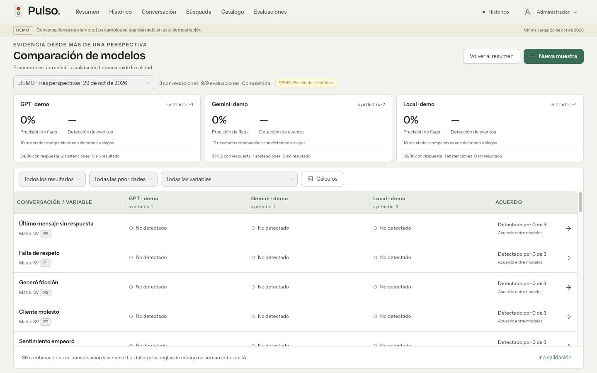

# QA intensivo — Pulso: modelos y comparación

Fecha: 29 de octubre de 2026. Rama: `codex/multi-model-evaluations`.

## Resumen ejecutivo

La entrega está lista para revisión funcional local. Se implementaron perfiles OpenAI/Gemini, comparación reproducible, validación humana a ciegas y contingencia con intentos persistidos. La conexión real de Gemini y la infraestructura local quedan pendientes, según el alcance aprobado. No se ejecutaron evaluaciones nuevas sobre conversaciones reales.

Se integraron los cambios de despliegue de `origin/main` hasta `ed2c0b6`. La aplicación admite `/pulso` en la prueba local y `/pulsoAtom` en producción mediante configuración.

## Estado general

| Área | Estado | Evidencia |
| --- | --- | --- |
| Arquitectura y configuración | Aprobado | `web/` y `api/` independientes; claves solo en backend; `.env` excluidos de Git. |
| API, permisos y persistencia | Aprobado | 61 pruebas API aprobadas; migración 002 aplicada y comprobada en `dbPulsosAtom`. |
| Rutas y despliegue | Aprobado localmente | 8 pruebas web aprobadas, incluyendo proxy, recargas y arranque mediante PM2; compilaciones para ambos prefijos. |
| Comparación y validación | Aprobado con datos sintéticos | Muestras de 2 y 3 modelos; discrepancias, evidencia, revisión a ciegas y revisión asistida comprobadas. |
| Contingencia | Aprobado por pruebas automatizadas | Reintentos limitados, identidad del respaldo, fallos dobles, abstención, rechazo de seguridad y reanudación. |
| UI y distribución | Aprobado en tamaños solicitados | Resumen, comparación y validación a 1366×768, 1440×900 y 1920×1080; sin desplazamiento exterior. |
| Proveedores reales nuevos | Pendiente de configuración | Gemini no habilitado; modelos locales pendientes de infraestructura. |
| Rendimiento a gran escala | Riesgo conocido | Persistencia JSON y lectura completa del histórico heredadas; no se hizo prueba de carga. |

## Hallazgos y riesgos por categoría

No quedaron defectos críticos o altos reproducidos en el alcance validado. Los límites siguientes siguen abiertos y no se presentan como pruebas aprobadas.

| ID | Categoría | Severidad | Hallazgo | Impacto | Evidencia | Recomendación |
| --- | --- | --- | --- | --- | --- | --- |
| QA-01 | Performance | Mejora sugerida | El bundle principal conserva la advertencia de Vite de tamaño superior a 500 kB: aproximadamente 882 kB, 283 kB gzip. | Puede aumentar la primera carga en redes lentas. | Compilaciones exitosas para `/pulso` y `/pulsoAtom`. | Medir el arranque en el entorno de destino y dividir dependencias pesadas si la medición lo justifica. |
| QA-02 | Datos / integraciones | Pendiente externo | El adaptador Gemini se probó con respuestas y fallos controlados, sin credenciales reales. | Aún no confirma conectividad ni compatibilidad del modelo que se elija. | Prueba del contrato `generateContent` y JSON Schema en `api/test/multi-model.test.js`. | Configurar el modelo exacto y ejecutar una muestra real explícita de pocos casos. |
| QA-03 | Performance | Riesgo no verificado | La arquitectura carga documentos JSON de Pulso y el histórico de Atom; las ejecuciones fuerzan lectura fresca. | Puede limitar volumen y concurrencia. | Inspección de `store.js`, `atom.js` y `evaluation-service.js`. | Dimensionar con volumen objetivo antes de aumentar los límites actuales. |
| QA-04 | Ruteo / despliegue | Requisito de publicación | El workflow existente omite las migraciones por diseño. | Un ambiente sin la migración 002 no puede cargar las nuevas tablas. | Workflow conservado sin modificar su política. | Ejecutar `npm run db:migrate` con la conexión del servidor antes del despliegue. La base validada ya tiene 002 aplicada. |
| QA-05 | Accesibilidad | Pendiente de auditoría ampliada | Se verificaron etiquetas, controles y distribución; no se hizo auditoría completa con lector de pantalla. | No permite afirmar conformidad integral de accesibilidad. | Inspección de controles y navegación del navegador. | Completar auditoría con teclado y lector de pantalla antes de exigir una certificación formal. |

## QA checklist

- [x] Selector de modelo consulta datos guardados, no ejecuta IA ni modifica referencias operativas.
- [x] Modelos habilitados separados de perfiles históricos y de los perfiles sintéticos de demo.
- [x] Políticas versionadas con control de concurrencia; supervisor no puede configurar ni iniciar lotes.
- [x] Muestras de hasta 20 conversaciones y 2–3 modelos diferentes; filtros de país, período y selección manual.
- [x] Selección aleatoria reproducible mediante miembros persistidos; incluye ambos grupos históricos cuando existen.
- [x] Huella de contenido, versiones del checklist, instrucciones y configuración conservadas por tarea.
- [x] Cambio de Atom entre modelos o antes de reanudar/validar exige nueva muestra.
- [x] Las tareas comparativas no reemplazan la evaluación oficial.
- [x] Código, reglas híbridas impuestas, reintentos y modelos efectivos repetidos no inflan los votos.
- [x] Fallos, pendientes y abstenciones se mantienen separados de “No detectado”.
- [x] API de validación entrega una lista blanca de campos, sin predicciones ni dictámenes anteriores.
- [x] Revelar un caso no expone los resultados de los restantes; las exposiciones quedan registradas.
- [x] Ver una predicción heredada marca conservadoramente la revisión posterior como asistida, sin incluir ese resultado heredado en la cohorte comparable.
- [x] Dictamen requiere todas las variables, motivo y evidencia para los eventos presentes; detecta sobrescrituras obsoletas.
- [x] Dictamen común aplica al seguimiento compatible y conserva las respuestas originales.
- [x] Precisión y detección usan la misma cohorte concluyente con referencia humana a ciegas; denominadores vacíos no muestran porcentajes inventados.
- [x] Fallo transitorio: un reintento por modelo y máximo un respaldo; comparaciones sin sustitución de modelo.
- [x] Configuración inválida, seguridad y abstención válida no disparan el respaldo.
- [x] Duplicados y reanudaciones preservan resultados completados y registran intentos.
- [x] Límites manual 20 / diario 100 y configuración diaria existente conservados.
- [x] Demo identificada y separada de datos reales; sin nuevas llamadas reales a proveedores durante QA.
- [x] Carga de pantallas y tablas conserva la animación de Pulso.
- [x] Resumen conserva el mapa como protagonista; tabla y paneles tienen desplazamiento interno.
- [x] Filtros, drawer de evidencia y tránsito entre resumen, histórico, comparación y validación comprobados.
- [x] Compilación y 69 pruebas automatizadas aprobadas (61 API + 8 web).
- [ ] Prueba real conjunta OpenAI + Gemini, una vez configurado Gemini.
- [ ] Conexión efectiva a modelos locales.
- [ ] Prueba de carga con el volumen de producción previsto.

## Conservación del histórico real

Antes y después de aplicar `002_multi_model.sql` se compararon conteos y huellas SHA-256 de todas las filas de las tablas existentes:

| Datos existentes | Cantidad | Resultado |
| --- | ---: | --- |
| Evaluaciones | 21 | Sin cambios |
| Revisiones humanas | 1 | Sin cambios |
| Variables | 130 | Sin cambios |
| Versiones de variables | 131 | Sin cambios |
| Configuración del portal | 1 | Sin cambios |

Se crearon ocho tablas y 16 referencias a evaluaciones operativas existentes. No se reemplazaron resultados, no se reevaluó el histórico y se conservó la programación diaria desactivada. Se comprobó lectura de 269 conversaciones de Atom. El health check posterior al reinicio respondió `ok`, modo `real`, almacenamiento MySQL disponible.

## Evidencia visual

La inspección en navegador confirmó dimensiones del documento iguales al viewport en las tres pantallas y tamaños solicitados. El área interna de comparación mide 259, 374 y 554 px de alto respectivamente. Transcripción y checklist conservan desplazamiento independiente; el drawer mantiene sus acciones accesibles. No se registraron errores de consola en los recorridos de demo comprobados.



Los porcentajes de esta imagen pertenecen a una prueba sintética de formularios y métricas; no describen la calidad de GPT, Gemini ni de un modelo local real.

## Prompts para cerrar pendientes

```text
Contexto: Pulso conserva web/ y api/ independientes y ruta base configurable.
Objetivo: validar la conexión real de Gemini después de recibir su configuración.
Instrucciones: comprobar el modelo exacto habilitado; elegir una muestra explícita
de pocos casos; ejecutar OpenAI y Gemini sobre esa misma muestra; revisar errores,
evidencia y trazabilidad. No reevaluar todo Atom ni cambiar referencias operativas.
Criterio: resultados reales identificados por proveedor/modelo y fallos visibles.
```

```text
Contexto: Pulso usa MysqlStore con documentos JSON y AtomReader con lectura histórica.
Objetivo: medir rendimiento con el volumen previsto de producción.
Instrucciones: usar un ambiente de prueba con volumen representativo; medir tiempo
de lectura, memoria y escritura de intentos; proponer paginación/consultas por caso
si existe un cuello de botella; mantener transacciones, huellas y permisos.
Criterio: límites y tiempos documentados sin modificar datos de producción.
```

## Criterio de salida

La rama puede revisarse con los tests y las compilaciones aprobados, sin defectos críticos/altos reproducidos. Para habilitar comparación real, falta configurar el segundo proveedor y validar una muestra explícita. Antes de publicar en otro ambiente, confirmar la migración 002 y los prefijos coincidentes de web/API. La infraestructura local y las pruebas de carga quedan fuera de esta primera conexión.
